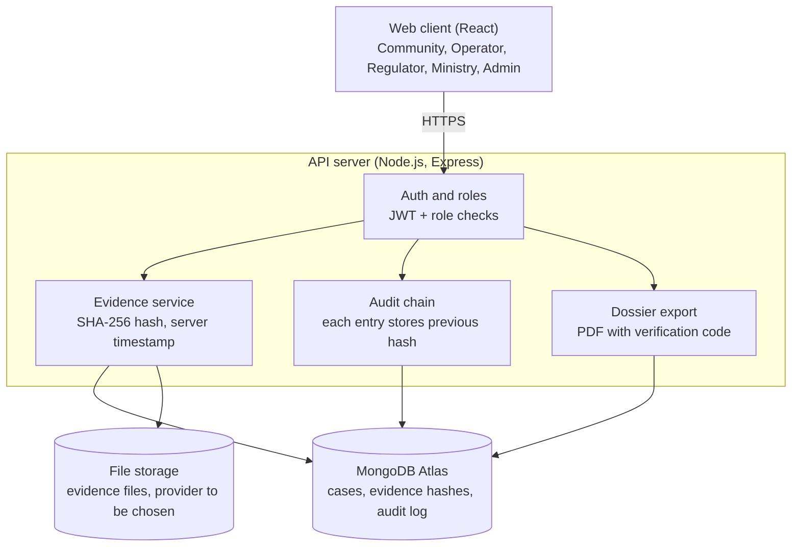

# Architecture

SpillProof is a three-tier web application with a separate evidence store and an integrity layer.

## Request flow for an evidence upload

1. The client sends the file with a JWT.
2. The auth layer checks the user's role and access to the case.
3. The evidence service computes the SHA-256 hash, adds the server timestamp, stores the file and saves the metadata.
4. The audit chain appends an entry containing the previous entry's hash.
5. The API returns the hash and timestamp to the client.

## Planned hosting

Vercel (client) and Render (API), as in earlier programme projects.
